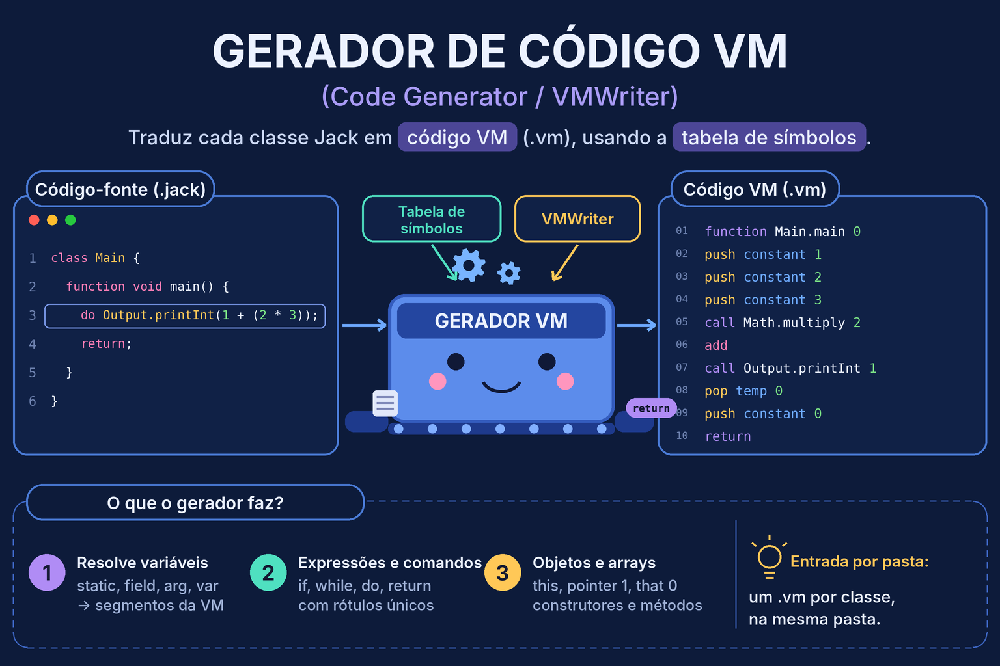
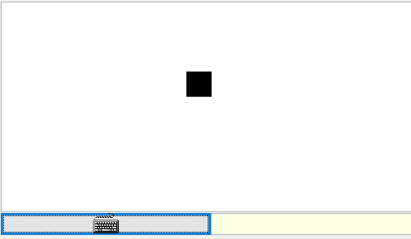
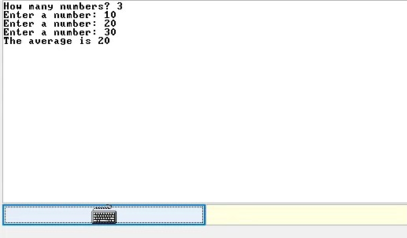
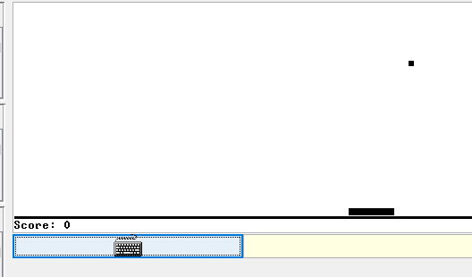
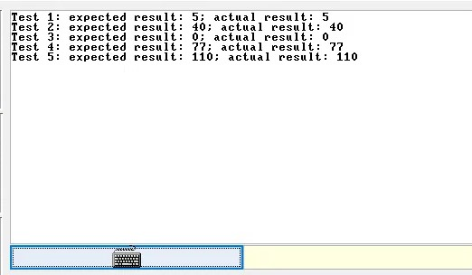

# jackcompiler

Compilador para a linguagem *Jack*, desenvolvido na disciplina de Compiladores.
Contém scanner, parser (*recursive descent*), tabela de símbolos e **gerador de código VM**, compatível com o VM Emulator do Nand2Tetris (Project 11). Aceita um arquivo `.jack` ou uma **pasta** com várias classes e gera um `.vm` por classe, na mesma pasta.

<p align="center">
  
  
</p>

## 👥 Integrantes

* Irlanda Hildeney Oliveira Teixeira — 20250013345
* Isaque Mendonça Costa — 20250042641

## ⚙️ Tecnologias

* **Linguagem:** Java (JDK 11 ou superior)
* **Testes:** JUnit 5 (Platform Console Standalone 1.12.0, baixado localmente — não versionado)
* **Saída:** arquivos `.vm` (e, opcionalmente, XML do scanner e do parser)

## 📁 Estrutura

```text
jackcompiler/
├── assets/                 # GIF e PNG usados neste README
├── examples/               # Programas Jack usados nos testes
├── lib/                    # JAR do JUnit (baixado manualmente, ignorado pelo Git)
├── projects/11/            # Seven, ConvertToBin, Square, Average, Pong, ComplexArrays
├── src/
│   ├── JackTokenizer.java      # Scanner
│   ├── Token.java / TokenType.java
│   ├── CompilationEngine.java  # Parser + geração de código (uma função por não-terminal)
│   ├── SymbolTable.java        # Tabela de símbolos (escopo de classe e de subrotina)
│   ├── VMWriter.java           # Escreve os comandos da VM
│   ├── XmlWriter.java
│   └── Main.java               # Entrada por arquivo ou pasta
├── test/                   # Testes JUnit e XMLs de referência (expected_xml/)
├── bin/ e output/          # gerados (ignorados pelo Git)
├── .gitignore / .gitattributes
└── README.md
```

## 🚀 Como compilar e executar

Todos os comandos são executados **na raiz do projeto** e usam caminhos relativos.

**1. Baixar o JUnit (uma vez)** — funciona em Linux, macOS e Windows 10+:

```
curl -L -o lib/junit-platform-console-standalone-1.12.0.jar https://repo1.maven.org/maven2/org/junit/platform/junit-platform-console-standalone/1.12.0/junit-platform-console-standalone-1.12.0.jar
```

**2. Compilar o projeto** (classes vão para `bin/`):

```
javac -encoding UTF-8 -d bin -cp lib/junit-platform-console-standalone-1.12.0.jar src/*.java test/*.java
```

**3. Gerar código VM**

Um arquivo (gera `Main.vm` ao lado do `.jack`):

```
java -cp bin Main projects/11/Seven/Main.jack
```

Uma pasta (gera um `.vm` por classe, na própria pasta, sem descer em subpastas):

```
java -cp bin Main projects/11/Pong/
```

**4. XML do parser e dos tokens (opcional)**

```
java -cp bin Main examples/Main.jack --xml output/Main.xml
java -cp bin Main examples/Main.jack --lexer output/MainT.xml
```

**5. Executar no VM Emulator:** abra o VM Emulator, use *Load Program* e escolha a **pasta** do programa (por exemplo, `projects/11/Pong/`). Não é preciso copiar os `.vm` do sistema operacional: o emulador já os tem embutidos.

> Os `.vm` gerados em `projects/` são ignorados pelo Git (`projects/**/*.vm`).

## ✅ Validação do Project 11

Todos os programas foram compilados com `java -cp bin Main <pasta>` e executados no VM Emulator.

| Etapa | Programa | O que exercita | Resultado esperado | Resultado |
| --- | --- | --- | --- | --- |
| 1 | Seven | expressão aritmética, `do`, chamada ao SO | imprime `7` | ✅ |


| 1 | ConvertToBin | `while`, `if` aninhados, `&`, `~` | `RAM[8001..8016]` com 0 ou 1, sem `-1` | ✅ |

| 2 | Square | construtores, métodos, campos, várias classes | quadrado move com as setas, `z`/`x` mudam o tamanho | ✅ |


| 2 | Average | arrays, strings constantes, teclado | pede N números e imprime a média | ✅ |


| 2 | Pong | programa orientado a objetos completo | bola, raquete e placar funcionando | ✅ |


| 2 | ComplexArrays | índices aninhados, arrays de arrays | valor esperado igual ao obtido | ✅ |


A tag `etapa1` marca o commit em que a geração de código e a entrada por diretório passaram a funcionar.


## 🧪 Testes automatizados

São 19 testes JUnit, todos passando. Cobrem o scanner (`LexerTest`), o parser contra os XMLs oficiais (`ParserTest`), a tabela de símbolos (`SymbolTableTest`), o `VMWriter` (`VMWriterTest`) e a geração de código para expressões, comandos e classes completas (`ExpressionCompilationTest`, `StatementCompilationTest`, `CompilationIntegrationTest`).

```
java -jar lib/junit-platform-console-standalone-1.12.0.jar execute --class-path bin --scan-class-path
```

Exemplos do `VMWriterTest`:

* `writePush("constant", 5)` → `push constant 5`
* `writeArithmetic("add")` → `add`
* `writeCall("Math.abs", 1)` → `call Math.abs 1`

## 🧩 Como as etapas se integram

1. **Scanner (`JackTokenizer`)** transforma o texto em tokens, com `peek()` e `advance()`.
2. **Parser (`CompilationEngine`)** consome os tokens por descida recursiva, uma função por não-terminal.
3. **Tabela de símbolos (`SymbolTable`)** guarda tipo, *kind* e índice de cada identificador, em dois escopos (classe e subrotina).
4. **Gerador (`VMWriter`)** escreve um comando VM por linha. O `CompilationEngine` consulta a tabela e chama o `VMWriter` durante a própria análise (passada única).

Mapeamento de variáveis para segmentos da VM:

| Jack | Segmento VM |
| --- | --- |
| `static` | `static` |
| `field` | `this` |
| parâmetro | `argument` |
| `var` | `local` |

## 📐 Gramática

Gramática Jack implementada (Apêndice A do livro):

```text
class:           'class' className '{' classVarDec* subroutineDec* '}'
classVarDec:     ('static'|'field') type varName (',' varName)* ';'
type:            'int' | 'char' | 'boolean' | className
subroutineDec:   ('constructor'|'function'|'method') ('void'|type) subroutineName '(' parameterList ')' subroutineBody
parameterList:   ((type varName) (',' type varName)*)?
subroutineBody:  '{' varDec* statements '}'
varDec:          'var' type varName (',' varName)* ';'
statements:      statement*
statement:       letStatement | ifStatement | whileStatement | doStatement | returnStatement
letStatement:    'let' varName ('[' expression ']')? '=' expression ';'
ifStatement:     'if' '(' expression ')' '{' statements '}' ('else' '{' statements '}')?
whileStatement:  'while' '(' expression ')' '{' statements '}'
doStatement:     'do' subroutineCall ';'
returnStatement: 'return' expression? ';'
expression:      term (op term)*
term:            integerConstant | stringConstant | keywordConstant | varName
               | varName '[' expression ']' | subroutineCall | '(' expression ')' | unaryOp term
subroutineCall:  subroutineName '(' expressionList ')'
               | (className|varName) '.' subroutineName '(' expressionList ')'
expressionList:  (expression (',' expression)*)?
op:              '+' | '-' | '*' | '/' | '&' | '|' | '<' | '>' | '='
unaryOp:         '-' | '~'
keywordConstant: 'true' | 'false' | 'null' | 'this'
```

Em Jack, `expression` é uma sequência `term (op term)*` avaliada da esquerda para a direita, sem precedência entre operadores.

## 💡 Decisões de projeto

* **Entrada por arquivo ou pasta:** para uma pasta, compila apenas os `.jack` dela (sem subpastas) e grava `Classe.vm` ao lado de `Classe.jack`. Um `CompilationEngine` e uma `SymbolTable` novos são criados para cada classe.
* **Geração em passada única:** o `CompilationEngine` consulta a `SymbolTable` e chama o `VMWriter` durante a própria análise.
* **Métodos:** `this` é definido na tabela como `argument 0`; os parâmetros declarados começam em `argument 1`. Na entrada: `push argument 0`, `pop pointer 0`.
* **Construtores:** `push constant <nº de fields>`, `call Memory.alloc 1`, `pop pointer 0`.
* **Chamadas:** `obj.metodo(...)` empilha `obj` como primeiro argumento e chama `Tipo.metodo n+1`, com o tipo vindo da tabela. `metodo(...)` sem prefixo empilha `pointer 0`.
* **Arrays:** em `let a[i] = expr`, o endereço `a + i` é calculado antes de `expr`; o valor passa por `temp 0` antes de `pop pointer 1` / `pop that 0`. Isso permite índices aninhados como `a[b[a[3]]]`.
* **Rótulos:** contador por classe (`IF_TRUE0`, `WHILE_EXP1`, ...), únicos mesmo com `if` e `while` aninhados.
* **Strings constantes:** `String.new(tamanho)` seguido de um `String.appendChar` por caractere.
* **Lookahead no scanner:** `peekNext()` distingue o operador `/` dos comentários `//` e `/* */`.
* **Fim de linha:** `.gitattributes` normaliza para LF, evitando diferenças entre Windows e Linux.

## 🤖 Uso de Inteligência Artificial

* **Ferramenta e modelo:** Claude Sonnet 5.5
* **Como foi usada:** Usada para tirar dúvidas sobre a especificação da VM, revisar a geração de código, orientar a validação e a organização do repositório
* **Papel da dupla:**
**Irlanda Hildeney** Geração de código nos métodos de compilação (`CompilationEngine`): expressões e termos, comandos (`let`, `if`, `while`, `do`, `return`), chamadas de função e de método, construtores, arrays e strings constantes. Integração da `SymbolTable` e do `VMWriter` ao parser. Entrada por arquivo ou pasta (`Main`), programas do Project 11, validação no VM Emulator, README e a tag `etapa1`. 
 **Isaque Costa** Implementação do `VMWriter` (escrita dos comandos da VM) e testes unitários da `SymbolTable`

* **Validação do resultado:** compilação dos seis programas do Project 11, execução de todos no VM Emulator e 19 testes JUnit passando.

## 📚 Desafios e aprendizados
A geração de código foi a etapa mais complexa do projeto, porque exigiu integrar três componentes já existentes: o parser, a tabela de símbolos e o `VMWriter`. Cada construção de Jack precisa ser traduzida para a pilha da máquina virtual, e um pequeno erro na ordem das instruções só aparece na execução. 

Os seis programas oficiais (`Seven`, `ConvertToBin`, `Square`, `Average`, `Pong` e `ComplexArrays`) foram executados no VM Emulator, e essa execução de inicio demorou um pouco para obter os resultados esperados, mas confirma que o código gerado funciona.

